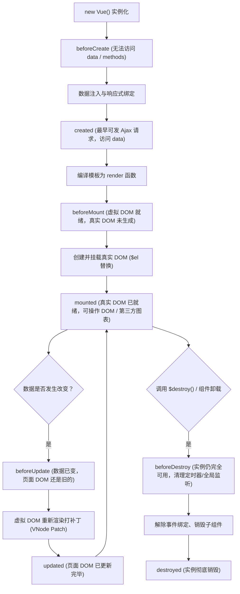

# 04 - Vue 实例生命周期（Lifecycle）

> **学习目标**：透彻理解 Vue 实例从“诞生（创建）”到“成长（挂载、更新）”再到“消亡（销毁）”的完整全生命周期过程。掌握各大钩子函数的触发时机、经典业务应用、父子组件执行时序、`$nextTick` 异步更新机制以及 `keep-alive` 专属生命周期。

---

## 一、学习前提

| 项 | 说明 |
| :--- | :--- |
| **Vue 版本** | 2.7.16（本地 `../js/vue.js`，与全项目保持一致） |
| **运行方式** | **纯原生 HTML 单文件**，双击任意 HTML 文件即可在浏览器中直接打开与交互验证，开箱即用 |
| **配套文件** | 包含基础概念、典型应用、父子时序、nextTick 原理及 keep-alive 缓存共 5 大进阶示例 |

---

## 二、文件清单（建议按序号顺序学习）

| 序号与文件名 | 核心内容 | 关键知识点与实战演示 |
| :--- | :--- | :--- |
| **[`01-生命周期.html`](file:///e:/vue/vue-basic-grammar/04-生命周期/01-生命周期.html)** | 四大阶段与八大钩子全景仪表盘 | `beforeCreate` / `created` / `beforeMount` / `mounted` / `beforeUpdate` / `updated` / `beforeDestroy` / `destroyed`，实时查看 $el 与 data 状态 |
| **[`02-生命周期的典型应用场景.html`](file:///e:/vue/vue-basic-grammar/04-生命周期/02-生命周期的典型应用场景.html)** | 3 大最高频实战应用 | `created` 异步请求预加载、`mounted` 操作真实 DOM / 绘制 Canvas、`beforeDestroy` 清除定时器与防内存泄漏 |
| **[`03-父子组件生命周期执行顺序.html`](file:///e:/vue/vue-basic-grammar/04-生命周期/03-父子组件生命周期执行顺序.html)** | 父子组件时序链条追踪（面试高频） | 挂载时序、属性更新时序、卸载销毁时序，“先父后子创建，先子后父挂载”核心机制剖析 |
| **[`04-异步更新DOM与nextTick实战.html`](file:///e:/vue/vue-basic-grammar/04-生命周期/04-异步更新DOM与nextTick实战.html)** | 异步 DOM 更新与 `$nextTick` 实战 | 异步队列机制、微任务原理、编辑框切换自动 `focus()`、聊天列表新增消息平滑滚到底部 |
| **[`05-keep-alive缓存与专属生命周期.html`](file:///e:/vue/vue-basic-grammar/04-生命周期/05-keep-alive缓存与专属生命周期.html)** | 动态组件缓存与激活状态保持 | `<keep-alive>` 标签、`activated`（激活）与 `deactivated`（失活）钩子、表单输入状态无损保持 |

---

## 三、生命周期核心速查表

---

## 四、经典高频面试题与避坑总结

### Q1：网络请求到底应该写在 `created` 还是 `mounted`？
> **答：**
> - **优先推荐 `created`**：此时已能访问 `data`，越早发起请求，页面白屏等待时间越短；同时在服务端渲染 (SSR) 中，只有 `created` 会被调用，`mounted` 不会调用。
> - **必须选 `mounted` 的场景**：如果网络请求的参数依赖真实 DOM 的尺寸计算（如根据容器宽度拉取图片），或者需要等待 DOM 元素挂载后再初始化图表（如 Echarts），则写在 `mounted`。

### Q2：父子组件生命周期的执行顺序是怎样的？
> **口诀：**
> 1. **初次挂载**：父 beforeCreate ➜ 父 created ➜ 父 beforeMount ➜ **子 beforeCreate ➜ 子 created ➜ 子 beforeMount ➜ 子 mounted** ➜ 父 mounted。  
>    *(解释：父组件必须等所有子组件渲染就绪后，自己才能真正完成挂载)*
> 2. **数据更新**：父 beforeUpdate ➜ 子 beforeUpdate ➜ 子 updated ➜ 父 updated。
> 3. **销毁卸载**：父 beforeDestroy ➜ 子 beforeDestroy ➜ 子 destroyed ➜ 父 destroyed。

### Q3：为什么需要 `$nextTick`？它的实现原理是什么？
> **答：**
> - **原因**：Vue 并不是数据一变就立刻重绘 DOM，而是采用**异步批处理更新队列**，将同一事件循环中对多个数据的修改进行缓冲去重。因此，在修改数据之后立即通过 DOM API 读取，读到的依然是旧 DOM。
> - **原理**：`$nextTick` 本质上利用了浏览器的异步微任务（`Promise.then` 优先，降级到 `MutationObserver`、`setImmediate`、`setTimeout`），确保回调在 DOM 渲染队列清空之后立即执行。

### Q4：为什么一定要在 `beforeDestroy` 里清理定时器或全局监听器？
> **答：**
> 组件从页面中移除后，Vue 只会清理组件内部的指令和子组件；而通过原生的 `setInterval`、`window.addEventListener` 绑定的全局回调，依然保存在内存中并持续运行，不仅浪费 CPU，还会导致已经被卸载的组件无法被垃圾回收机制释放，引发严重的**内存泄漏（Memory Leak）**。
